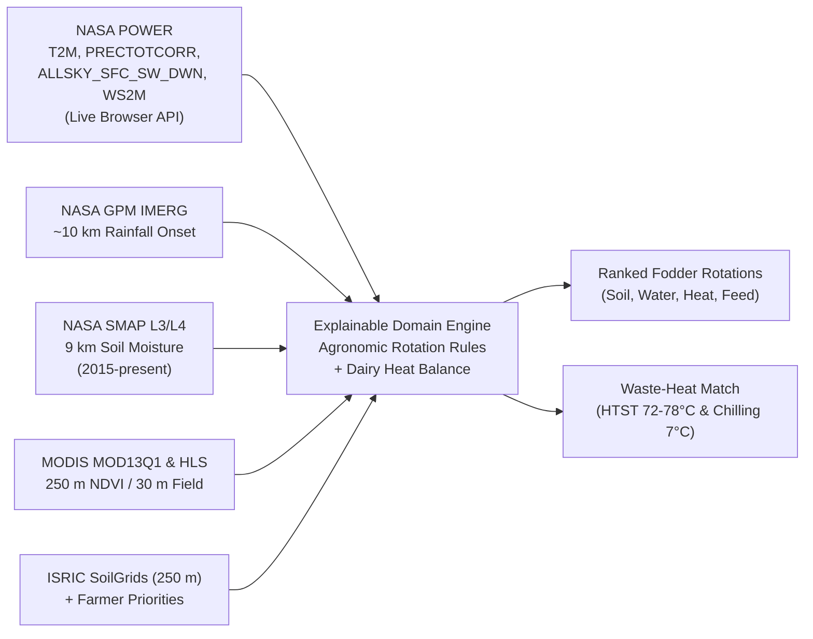

# Best Use of Data: NASA Earth Observations & Domain-First Pipeline

> **Design principle:** **MilkyWays** pairs **NASA Earth observations** with **explainable agronomy and dairy thermodynamics**—so every recommendation is traceable from satellite measurement to field and milk-plant decision.

---

## 1. Data-to-Decision Pipeline

---

## 2. Exact Dataset Mapping

At least one NASA dataset is mandatory for Global Awards eligibility. **MilkyWays** queries **NASA POWER live in the browser** (no API key required) and documents how each complementary NASA layer feeds the decision engine:

| Dataset | Exact Variables Used | Domain / Physics Role in MilkyWays | Resolution & Coverage | Source |
|---|---|---|---|---|
| **NASA POWER** (`community=AG`) — *Live in App* | `T2M`, `T2M_MAX`, `T2M_MIN`, `PRECTOTCORR`, `ALLSKY_SFC_SW_DWN`, `WS2M` | Computes growing-season heat stress, solar irradiance (PAR proxy), and baseline water balance to score C3 (alfalfa/clover) vs. C4 (maize/sorghum) fodder | ~50 km grid, daily & climatology | [power.larc.nasa.gov](https://power.larc.nasa.gov/api/temporal/daily/point) |
| **NASA GPM IMERG** | Satellite precipitation rate | Resolves rainfall onset and planting-window timing where 50 km POWER is too coarse | ~10 km satellite rainfall | [gpm.nasa.gov](https://gpm.nasa.gov/data/imerg) |
| **NASA SMAP** (`SPL3SMP_E` L3 / L4) | Surface & root-zone soil moisture (`m³/m³`) | Flags current soil moisture deficit before seeding deep-rooted legumes vs. shallow silage | 9 km daily (2015–present) | [Earthdata Agriculture](https://www.earthdata.nasa.gov/topics/human-dimensions/agriculture-production/data-access-tools) |
| **MODIS `MOD13Q1`** | 16-day NDVI / EVI | Tracks multi-season crop vigor to verify whether legume breaks improve subsequent silage greenness | 250 m, 16-day (2000–present) | [Earthdata Agriculture](https://www.earthdata.nasa.gov/topics/human-dimensions/agriculture-production/data-access-tools) |
| **Landsat / HLS** | 30 m surface reflectance | Field-level bare-ground, residue cover, and active cropland vs. industrial parcel mapping | 30 m | [Earthdata Agriculture](https://www.earthdata.nasa.gov/topics/human-dimensions/agriculture-production/data-access-tools) |
| **NASA GRACE & GRACE-FO** | Groundwater storage anomaly | Flags aquifers already stressed by dairy irrigation before high-water data centers site nearby | Regional (~300 km) | [grace.jpl.nasa.gov](https://grace.jpl.nasa.gov/) |
| **NASA ECOSTRESS** | Land surface temp & evapotranspiration | Models thermal exhaust heat islands and pasture moisture stress around co-located facilities | ~70 m | [ecostress.jpl.nasa.gov](https://ecostress.jpl.nasa.gov/) |
| **NASA VIIRS Black Marble** | Nighttime lights radiance | Infers existing electrical grid and industrial corridors for **Grid & Heat Proximity** scoring | 500 m | [blackmarble.gsfc.nasa.gov](https://blackmarble.gsfc.nasa.gov/) |
| **ISRIC SoilGrids** *(non-NASA)* | Clay/sand/silt %, organic carbon, pH | Local soil texture & water-holding capacity combined with farmer priorities | 250 m global soil grid | [soilgrids.org](https://soilgrids.org/) |

---

## 2b. Open-Source AI Data Center & Infrastructure Datasets (Anti-Hallucination Grounding)

Because hyperscale AI infrastructure is proprietary, no single government registry lists every facility. To prevent hallucinated locations, **MilkyWays** grounds its regional waste-heat & co-location workflow in four public, satellite-verified open datasets:

| Dataset | Coverage & Focus | Available Formats | Best Use in MilkyWays | Source |
| :--- | :--- | :--- | :--- | :--- |
| **IM3 Open Source Data Center Atlas** (PNNL / DOE) | U.S. existing & projected facilities (`250,000+ sq ft` hyperscale AI filter), transmission lines, public water service areas | GeoPackage (`GPKG`), CSV | U.S. rural farm-conflict modeling with water & grid overlays | [immm-sfa.github.io/datacenter-atlas](https://immm-sfa.github.io/datacenter-atlas/) |
| **Data Center Atlas** (`kiankyars/datacenter-atlas`) | Global AI & hyperscale construction (announced, under-construction, operating) with dated evidence | CSV, GeoJSON, SQLite, KML, JSON API | Tracking upcoming AI builds before they appear on standard maps | [github.com/kiankyars/datacenter-atlas](https://github.com/kiankyars/datacenter-atlas) |
| **ATLAS** (`Ringmast4r/Global-Data-Center-Map`) | Global directory (`18,110+` facilities across `116` countries; `6,100+` exact GPS coords) | GeoJSON, CSV, JSON, Parquet, SQLite | Global hyperscaler filtering (AWS, Google, Microsoft, Meta) | [github.com/Ringmast4r/Global-Data-Center-Map](https://github.com/ringmast4r/Global-Data-Center-Map) |
| **PeeringDB Facility Exports** | Global colocation & interconnection hubs (`5,200+` facilities) | Daily `.KMZ`, REST API (JSON) | Dynamic facility coordinate queries in live web apps | [docs.peeringdb.com](https://docs.peeringdb.com/blog/peeringdb_map_with_kmz/) |

---

## 2c. Open-Source Dairy Farm & Livestock Datasets (Privacy-Compliant Grounding)

Because farm addresses are protected under agricultural privacy laws in many countries, no single global point file lists every dairy farm. Researchers and municipal planners combine global cattle density rasters with public environmental CAFO permit registries, computer-vision barn footprints, and NASA methane facility detections:

| Dataset | Coverage & Scale | Available Formats | Why It Works in MilkyWays | Source |
| :--- | :--- | :--- | :--- | :--- |
| **FAO Gridded Livestock of the World (`GLW 4`)** | Global (`~10 km` / 5 arc-minute resolution) | GeoTIFF (Raster) | Global cattle abundance heatmap to score overlap against ATLAS data centers | [fao.org/livestock-systems](https://www.fao.org/livestock-systems/global-distributions/en/) |
| **Cal-FF Factory Farm Census** | California, USA (`2,121` facilities; 98% of state CAFOs, including dairy) | CSV, GeoJSON (Hugging Face) | Aerial-CV barn/lagoon polygons and exact dairy classifications | [Nature Scientific Data (2025)](https://www.nature.com/articles/s41597-025-06082-6) |
| **State CAFO Permit Registries (ArcGIS Hub)** | U.S. Dairy States (New York, Michigan, Wisconsin, etc.) | GeoJSON, Shapefile, CSV | Public environmental agency GPS points for regulated dairy operations | [ArcGIS Hub (`tags=farms`)](https://hub.arcgis.com/search?collection=dataset&tags=farms) |
| **OpenStreetMap (`Overpass API`)** | Global (crowd-sourced farmyards, barns, pastures) | GeoJSON, CSV, KML | Query `landuse=farmyard` or `building=cowshed` inside any thermal buffer zone | [openstreetmap.org](https://www.openstreetmap.org/) |
| **UK Registered Dairy Establishments** | United Kingdom (updated monthly) | CSV | Postcodes & establishment names ready to geocode into UK/EU map pins | [data.gov.uk](https://www.data.gov.uk/dataset/61ce0cbc-3c0e-4311-8021-ff439138eaee/list-of-registered-dairy-establishments) |
| **NASA CMS / Vista-CA** *(Methane & Biogas)* | California San Joaquin Valley | GeoJSON / Aerial AI layer | Maps dairy facilities & manure lagoons for CH₄ biogas + backup generator synergy | [carbon.nasa.gov](https://carbon.nasa.gov/) |

### Reproducible Spatial-Join Method (Data Centers × Dairy Farms)

To identify co-location corridors without hallucinating links:
1. Reproject both the Data Center layer (`IM3` / `ATLAS`, filtered to `≥ 250,000 sq ft` campuses) and Dairy layer (`Cal-FF` / `State CAFOs` / `OSM`) into a metric CRS (`EPSG:3857` or local UTM).
2. Buffer each data center by the viable thermal pipe radius (`5–12 km`, e.g., `datacenters.geometry.buffer(12000)`).
3. Run `gpd.sjoin(dairy_farms, datacenter_buffers, predicate="within")` to isolate viable pipe corridors vs. `> 12 km` Position Beacons.
4. Sample **NASA GRACE-FO** (groundwater anomaly) and **NASA ECOSTRESS** (`~70 m` LST) pixels at each intersection.

---

## 3. Honest Limits & Validation

To avoid black-box overclaiming, **MilkyWays** states its data and engineering boundaries explicitly:

1. **Spatial resolution mismatch:** NASA POWER (`~50 km`) captures regional climate, not individual 10-acre paddocks — so **GPM IMERG (`~10 km`)**, **SMAP (`9 km`)**, **MODIS (`250 m`)**, and **Landsat/HLS (`30 m`)** are paired for field-scale refinement.
2. **Temporal record limit:** SMAP begins in **2015**; it is used strictly for **current soil-moisture conditions**, never for 20-year climate trend claims.
3. **Explainable scoring, not black-box ML:** Rotation scores are deterministic, rule-based, and weighted by the farmer's own priority sliders (Soil Health, Water Efficiency, Heat Resilience, Feed Quality).
4. **Verified baseline (`44.08°N, 79.88°W`, Ontario Dairy Region):** Live NASA POWER query returns `T2M = 7.00 °C` (`-7.25 °C` Jan to `21.20 °C` Jul), `PRECTOTCORR = 2.16 mm/day`, `ALLSKY_SFC_SW_DWN = 13.05 MJ/m²/day`, `WS2M = 2.98 m/s`.
