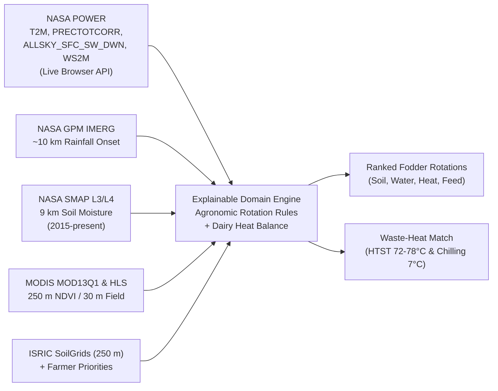

# Best Use of Data: NASA Earth Observations & Domain-First Pipeline

> **Design principle:** **MilkyWays** pairs **NASA Earth observations** with **explainable agronomy and dairy thermodynamics**—so every recommendation is traceable from satellite measurement to field and milk-plant decision.

---

## 1. Data-to-Decision Pipeline

---

## 2. Exact Dataset Mapping

At least one NASA dataset is mandatory for Global Awards eligibility. **MilkyWays** queries **NASA POWER live in the browser** (no API key required) and documents how each complementary NASA layer feeds the decision engine:

| Dataset | Exact Variables Used | Domain / Physics Role in MilkyWays | Resolution & Coverage | Source |
|---|---|---|---|---|
| **NASA POWER** (`community=AG`) — *Live in App* | `T2M`, `T2M_MAX`, `T2M_MIN`, `PRECTOTCORR`, `ALLSKY_SFC_SW_DWN`, `WS2M` | Computes growing-season heat stress, solar irradiance (PAR proxy), and baseline water balance to score C3 (alfalfa/clover) vs. C4 (maize/sorghum) fodder | ~50 km grid, daily & climatology | [power.larc.nasa.gov](https://power.larc.nasa.gov/api/temporal/daily/point) |
| **NASA GPM IMERG** | Satellite precipitation rate | Resolves rainfall onset and planting-window timing where 50 km POWER is too coarse | ~10 km satellite rainfall | [gpm.nasa.gov](https://gpm.nasa.gov/data/imerg) |
| **NASA SMAP** (`SPL3SMP_E` L3 / L4) | Surface & root-zone soil moisture (`m³/m³`) | Flags current soil moisture deficit before seeding deep-rooted legumes vs. shallow silage | 9 km daily (2015–present) | [Earthdata Agriculture](https://www.earthdata.nasa.gov/topics/human-dimensions/agriculture-production/data-access-tools) |
| **MODIS `MOD13Q1`** | 16-day NDVI / EVI | Tracks multi-season crop vigor to verify whether legume breaks improve subsequent silage greenness | 250 m, 16-day (2000–present) | [Earthdata Agriculture](https://www.earthdata.nasa.gov/topics/human-dimensions/agriculture-production/data-access-tools) |
| **Landsat / HLS** | 30 m surface reflectance | Field-level bare-ground, residue cover, and paddock-scale verification | 30 m | [Earthdata Agriculture](https://www.earthdata.nasa.gov/topics/human-dimensions/agriculture-production/data-access-tools) |
| **ISRIC SoilGrids** *(non-NASA)* | Clay/sand/silt %, organic carbon, pH | Local soil texture & water-holding capacity combined with farmer priorities | 250 m global soil grid | [soilgrids.org](https://soilgrids.org/) |

---

## 3. Honest Limits & Validation

To avoid black-box overclaiming, **MilkyWays** states its data and engineering boundaries explicitly:

1. **Spatial resolution mismatch:** NASA POWER (`~50 km`) captures regional climate, not individual 10-acre paddocks — so **GPM IMERG (`~10 km`)**, **SMAP (`9 km`)**, **MODIS (`250 m`)**, and **Landsat/HLS (`30 m`)** are paired for field-scale refinement.
2. **Temporal record limit:** SMAP begins in **2015**; it is used strictly for **current soil-moisture conditions**, never for 20-year climate trend claims.
3. **Explainable scoring, not black-box ML:** Rotation scores are deterministic, rule-based, and weighted by the farmer's own priority sliders (Soil Health, Water Efficiency, Heat Resilience, Feed Quality).
4. **Verified baseline (`44.08°N, 79.88°W`, Ontario Dairy Region):** Live NASA POWER query returns `T2M = 7.00 °C` (`-7.25 °C` Jan to `21.20 °C` Jul), `PRECTOTCORR = 2.16 mm/day`, `ALLSKY_SFC_SW_DWN = 13.05 MJ/m²/day`, `WS2M = 2.98 m/s`.
