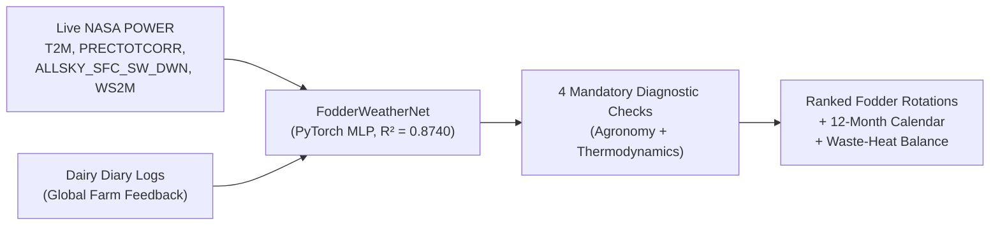

# MilkyWays &mdash; Data Center Dairy Diary

**The decision tool that learns from farms and data centers around the world.** &mdash; *NASA Space Apps Challenge Singapore 2026 (Challenge 7: Field Shift)*

> **What fodder rotation should this dairy farm plant next?**

**MilkyWays** is a predictive decision-support and diagnostic tool for an industrial dairy farm located next to an AI data center. It combines **live NASA Earth observations**, **local soil characteristics**, **fodder crop traits**, and **farmer priorities** with a **PyTorch deep learning model (`FodderWeatherNet`)** guarded by **four mandatory agronomic and thermodynamic checks**—while pairing the dairy plant's thermal load with closed-loop data center waste heat.

[Launch Interactive Tool](app/index.html){ .md-button .md-button--primary }
[Read Technical Paper](paper.md){ .md-button }

---

## Deep Learning + Diagnostic Guardrails

Weather-to-fodder stress relationships are non-linear and shared across agricultural regions globally, so **MilkyWays** pairs a neural network with deterministic physical guardrails:

1. **Predictive Layer (`FodderWeatherNet`):** A PyTorch 3-layer MLP (`8 → 32 → 16 → 3`) trained on **10 years of daily NASA POWER data (`2016–2025`)** across 6 global dairy regions (out-of-sample `R² = 0.8740`, `MAE = 5.27`, outperforming Ridge `R² = 0.8553`), running live inference in the browser and learning from on-farm **Dairy Diary** logs.
2. **Diagnostic Layer (4 Mandatory Checks):** Every forecast must pass deterministic checks for **Heat & Solar PAR**, **Water & Soil Drainage**, **25–30% Nitrogen-Fixation Cycle**, and **Waste-Heat & Double-Wall Isolation** (`PASS` / `FAIL`) with explicit positive and negative controls.

---

## Cows and Servers, Milk and Heat

A dairy processing plant is roughly **70% thermal energy and 30% electricity**. An AI data center rejects low-grade heat 24 hours a day. Putting them side by side turns rural grid/water competition into circular efficiency:

- **In the field:** NASA POWER, GPM IMERG, SMAP, and MODIS data guide the farm's rotation between **energy silage** (maize, sorghum) and **nitrogen-fixing legumes** (alfalfa, clover, cowpea, berseem) — cutting synthetic nitrogen fertilizer needs by **25–30%**.
- **In the dairy plant:** Closed-loop data center waste heat (boosted via heat pump to `70–90 °C`) handles **HTST pasteurization (`72–78 °C`)** and drives **absorption chilling (`~7.2 °C`)** via a double-wall heat exchanger. See [Waste Heat & Safety](waste-heat.md) for engineering details and the Gais, Switzerland (`1.5 GWh/year`) benchmark.
