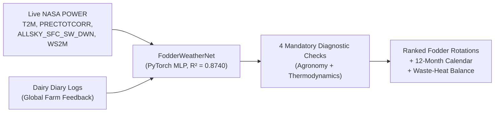

# MilkyWays &mdash; Data Center Dairy Diary

**The decision tool that learns from farms and data centers around the world.** &mdash; *NASA Space Apps Challenge Singapore 2026 (Challenge 7: Field Shift)*

> **What fodder rotation should this dairy farm plant next?**

**MilkyWays** is a predictive decision-support and diagnostic tool for an industrial dairy farm located next to an AI data center. It queries **live NASA POWER 25-year agroclimatology (`2001–2025`, `~50 km` grid)** in the browser, combines it with **local soil characteristics**, **fodder crop traits**, and **farmer priorities**, and runs a **PyTorch-trained MLP (`FodderWeatherNet`, exported to `model_weights.json` for live JS inference)** guarded by **four mandatory agronomic and thermodynamic checks**—while pairing the dairy plant's thermal load with closed-loop data center waste heat. *(GPM IMERG, SMAP, MODIS, HLS, and SoilGrids are documented as planned field-scale integration layers; see [NASA Datasets](datasets.md).)*

[Launch Interactive Tool](app/index.html){ .md-button .md-button--primary }
[Read Technical Paper](paper.md){ .md-button }
[Model Card](model-card.md){ .md-button }

!!! tip "Try it in 3 steps"
    1. **[Open the Interactive Tool](app/index.html)** &rarr; 2. Pick **Gais Dairy Reference, Switzerland** (or **Singapore Tropical Dairy Demo**) &rarr; 3. Click **Fetch NASA POWER Climatology & Rank** (or **Export Municipal Report**).  
    *Why Singapore?* Singapore is our high-density urban cooling and import-resilience testbed—where tropical heat (`~27.1 °C`) stresses temperate dairy fodder and circular data-center waste heat (`55–70 °C`) bridges pasteurization and absorption chilling.

---

## Challenge 7 Brief Alignment

| Challenge 7 Goal | What **MilkyWays** Delivers Live |
| :--- | :--- |
| **Compare rotations & reveal tradeoffs** | 4 rotations (incl. N-fixing & negative control) + **6 Farm & Municipal MCDA sliders** (Soil, Water, Heat, Feed, Grid Proximity, Flood Buffer) that visibly re-rank winners |
| **Understand risk & make uncertainty visible** | **4 Mandatory Checks**, **Open-Water Hard Exclusion Gate**, `FodderWeatherNet` Stress Risk, and honest `~50 km` POWER / `2015+` SMAP limits |
| **Build an AI model** | **PyTorch-trained `FodderWeatherNet`** (`R² = 0.8740` vs. Ridge `0.8553`; exported to `model_weights.json`, JS forward pass in browser — see [Model Card](model-card.md)) + transparent **Inside the Tuning** WLC formula |
| **An interactive map** | **Leaflet Satellite + Topo World View** with **14 global farms**, dynamic **NASA MCDA raster grid**, & **Zoom-Out Synergy Spider** |
| **Web app & decision support tool** | **Zero-install browser SDSS**, **12-Month Calendar**, **Dairy Diary**, & **Symbiotic Co-Location** (`55–70 °C` data-center loop → `72–78 °C` HTST) |

---

## Deep Learning + Diagnostic Guardrails

Weather-to-fodder stress relationships are non-linear and shared across agricultural regions globally, so **MilkyWays** pairs a neural network with deterministic physical guardrails:

1. **Predictive Layer (`FodderWeatherNet`):** A PyTorch 3-layer MLP (`8 → 32 → 16 → 3`) trained offline on **10 years of daily NASA POWER data (`2016–2025`)** across 6 global dairy regions (out-of-sample `2023–2025` `R² = 0.8740`, `MAE = 5.27`, outperforming Ridge `R² = 0.8553`), exported to `model_weights.json` for live browser inference and calibrated by on-farm **Dairy Diary** logs. See [Model Card](model-card.md).
2. **Diagnostic Layer (4 Mandatory Checks):** Every forecast must pass deterministic checks for **Heat & Solar PAR**, **Water & Soil Drainage**, **25–30% Nitrogen-Fixation Cycle**, and **Waste-Heat & Double-Wall Isolation** (`PASS` / `FAIL`) with explicit positive and negative controls.

---

## Cows and Servers, Milk and Heat

A dairy processing plant is roughly **70% thermal energy and 30% electricity**. An AI data center rejects low-grade heat 24 hours a day. Putting them side by side turns rural grid/water competition into circular efficiency:

- **In the field:** Live **NASA POWER (`2001–2025` climatology)** guides the farm's rotation between **energy silage** (maize, sorghum) and **nitrogen-fixing legumes** (alfalfa, clover, cowpea, berseem) — cutting synthetic nitrogen fertilizer needs by **25–30%** *(with GPM IMERG, SMAP, and MODIS documented as planned higher-resolution layers)*.
- **In the dairy plant:** Closed-loop data center waste heat (boosted via heat pump to `70–90 °C`) handles **HTST pasteurization (`72–78 °C`)** and drives **absorption chilling (`~7.2 °C`)** via a double-wall heat exchanger. See [Waste Heat & Safety](waste-heat.md) for engineering details and the Gais, Switzerland (`1.5 GWh/year`) benchmark.
