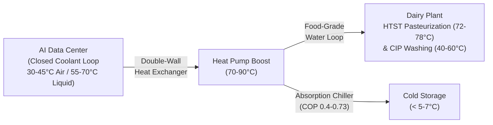

# MilkyWays

**NASA Space Apps Challenge Singapore 2026 — Challenge 7: *Field Shift: Adapting Farms with NASA Data***

> **What fodder rotation should this dairy farm plant next?**

**MilkyWays** is a decision-support tool for an industrial dairy farm located next to an AI data center. It combines **NASA Earth observations**, **local soil characteristics**, **fodder crop traits**, and **farmer priorities** to rank crop rotations by soil health, water use, heat risk, and dairy feed quality — while pairing the farm's milk pasteurization and cooling with indirect data center waste heat.

[Launch Interactive Tool](app/index.html){ .md-button .md-button--primary }
[Explore NASA Datasets](datasets.md){ .md-button }

---

## Cows and Servers, Milk and Heat

A dairy processing plant is roughly **70% thermal energy and 30% electricity**. An AI data center rejects low-grade heat 24 hours a day. Putting them side by side closes the loop:

1. **In the field:** NASA POWER, GPM IMERG, SMAP, and MODIS data guide the farm's rotation between **energy silage** (maize, sorghum) and **nitrogen-fixing legumes** (alfalfa/lucerne, clover, cowpea, berseem) — cutting nitrogen fertilizer needs by **25–30%** compared with cereal monocrops.
2. **In the dairy plant:** Data center waste heat (boosted via heat pump) handles **HTST pasteurization (72–78 °C)** and **CIP washing (40–60 °C)**, then drives **absorption chilling (~7.2 °C)** for milk storage.

### Safety First: *"The Coolant Never Touches the Milk"*

No data center coolant ever comes near the milk. Heat transfers across a **double-wall heat exchanger** into a separate **food-grade water loop** — the same indirect architecture proven at commercial scale in the **Gais, Switzerland** mountain cheese dairy (**1.5 GWh/year**).
